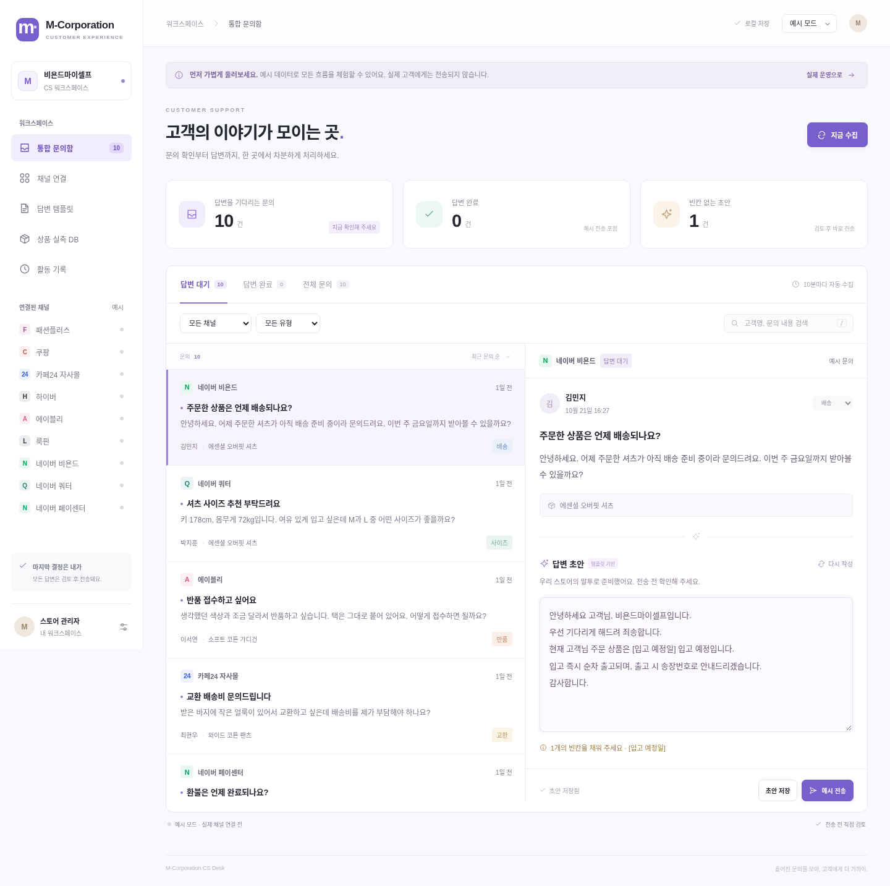

# M-Corporation · CS Desk

흩어진 쇼핑몰 고객 문의를 한곳에서 검토하고 답변하는 한국어 웹 프로그램입니다. 첨부된 `GPT-6.pdf`의 CS 자동화 설명을 바탕으로 구현했습니다.

기본 운영 쇼핑몰은 **비욘드마이셀프**입니다. 네이버 쿼터 채널의 답변 상호는 **쿼터**로 별도 설정했습니다. 워크스페이스와 답변 인사말에 적용되며, 답변 템플릿 설정에서 변경할 수 있습니다.



## 실행

**Node.js 24 이상**이 필요합니다.

**윈도우·웨일 사용자:** [윈도우 시작 안내](docs/WINDOWS.md)에 따라 `01-install.cmd` → `02-start.cmd` 순서로 실행하세요. 쇼핑몰 로그인은 서버를 종료한 뒤 `03-login.cmd`에서 사이트 번호를 선택합니다. 관리 화면은 웨일에서 사용할 수 있지만 쇼핑몰 로그인은 전용 브라우저에 따로 저장됩니다.

ZIP을 내려받았다면 압축을 푼 `M-Corporation` 폴더에서 아래 명령을 실행하세요. 클라우드의 폴더는 `/workspace/M-Corporation`입니다.

```bash
cd M-Corporation
npm ci
npx playwright install chromium
npm start
```

터미널에 표시되는 로컬 주소를 개인 PC의 브라우저에서 엽니다. 기본 포트는 `3000`입니다. 이 클라우드 환경에는 `/usr/bin/chromium`이 이미 설치되어 있어 `playwright install` 단계를 생략할 수 있습니다. 개발 중 자동 재시작은 `npm run dev`를 사용하세요.

처음 열면 **예시 모드**입니다. 예시 문의 10건과 상품 실측을 이용해 편집·검색·검토·전송을 체험할 수 있습니다. 예시 전송은 외부 게시를 하지 않으며 실제 문의 및 실측 DB와 분리되어 있습니다. 상호·템플릿·채널 설정은 두 모드가 공유합니다.

## 구현된 기능

- 실제 사용 채널에 맞춘 **9개 로그인 프로필 / 18개 문의·알림함**: 패션플러스 CS알리미·고객문의 게시판, 쿠팡 2종, 카페24, 하이버, 에이블리, 룩핀 2종, 네이버 비욘드 4종, 네이버 쿼터 4종, 네이버 페이센터.
- 네이버 두 계정은 독립 브라우저 프로필·문의 ID·답변 상호를 사용하며, 수집과 전송 전에 로그인 스토어명을 검증합니다.
- 카페24·하이버의 조회 기간을 한국 시간 기준 최근 30일로 자동 갱신합니다. 연결 설정에서 기간을 조정하거나 고정 날짜로 전환할 수 있습니다.
- 서버 실행 중 10분 주기 수집, 수동 수집, 페이지네이션, 고유 ID 중복 제거, 채널별 오류 표시.
- 문의 목록·대기/완료 건수, 채널/유형/상태 필터, 고객·본문·상품 검색, 원문 링크.
- 배송·반품·교환·환불·할인·사이즈·기타 **규칙 기반** 분류와 편집 가능한 7종 템플릿 초안. 외부 AI API나 모델 계정은 필요하지 않습니다.
- 답변 편집·저장·재작성, 빈칸 전송 차단, 수신자와 최종 내용을 검토한 후 전송.
- 승인 버전 검사, 중복 요청 차단, 원문 문의 ID 대조, 실제 게시 내용 확인, 불확실한 결과의 수동 확인.
- 상품 실측 입력·수정·JSON 가져오기·공개 상품 페이지 텍스트 수집 및 사이즈 초안 반영.
- SQLite 영속 저장, 처리 이력, 데스크톱/모바일 화면.

**제공된 18개 URL은 등록했으며 실제 로그인 후 수집·전송은 아직 검증하지 않았습니다.** 클라우드 브라우저에서 6개 플랫폼의 로그인 화면과 스마트스토어 공개 홈을 확인했지만, 이 클라우드에는 로그인 세션·DOM 매핑이 아직 없습니다. 카페24 문의 주소는 HTTP 403을 반환했고, 관리자 진입 주소는 별도 로그인 서버로 이동하다 차단되었습니다. 관련 18개 호스트를 환경 설정 초안에 저장했으며, 초안 저장과 실행 환경 적용은 별개입니다. 범용 브라우저 어댑터는 테스트 쇼핑몰에서 수집부터 게시까지 검증했습니다. 연결 절차와 플랫폼별 접속 상태는 [채널 연결 안내](docs/CHANNELS.md)에 정리했습니다.

## 사용 순서

1. 예시 모드에서 문의를 선택합니다. 빈칸을 채우고 **예시 전송 → 내용 확인 · 전송**으로 흐름을 확인합니다.
2. **답변 템플릿**에서 상호와 실제 반품·교환·환불 정책을 입력합니다. 기본 문구는 초안용 예시이므로 자신의 운영 규정으로 검토하세요.
3. **채널 연결**에서 미리 등록된 문의 관리 URL을 확인하고, 해당 PC에서 `npm run login -- 채널ID`로 직접 로그인합니다. [선택자 매핑](docs/CHANNELS.md)을 마칩니다.
4. **실제 운영 → 지금 수집**을 누릅니다. 수집된 문의와 플랫폼 원문이 일치하는지 확인합니다.
5. 답변을 검토하고 전송합니다. 빈칸이 있거나 게시 상태가 불확실하면 완료 처리하지 않습니다.

문서의 부가 아이디어인 TOP10 통계, 아침 요약 발송, 전체 상품 카탈로그 자동 탐색은 현재 구현 범위에 포함하지 않습니다. 키·몸무게만으로 착용 사이즈를 단정하지 않으며, 저장된 실측과 개인차 안내를 제공합니다.

## 저장과 운영

| 항목 | 위치/설정 |
| --- | --- |
| 문의, 초안, 실측, 설정, 활동 기록 | `.data/desk.sqlite` |
| 채널별 브라우저 로그인 | `.data/profiles/<channelId>` |
| 데이터 위치 변경 | `CS_DATA_DIR` 환경변수 |
| Chromium 경로 지정 | `CS_CHROMIUM_PATH` 환경변수 |
| 포트 변경 | `PORT` 환경변수 |
| 시간 표시 | 한국 시간(Asia/Seoul) |

데이터와 로그인 세션은 Git에서 제외됩니다. 브라우저 프로필에는 로그인 쿠키가 있으므로 개인 환경에서 보관하세요. 백업은 서버를 종료한 뒤 `.data` 전체를 복사합니다. 프로그램이나 PC가 꺼져 있으면 수집되지 않습니다. 새 머신에서는 서버를 다시 시작하고 로그인 상태를 확인해야 합니다.

기본 서버는 `127.0.0.1`에만 바인딩하며 동일 출처 JSON 요청을 검사합니다. **단일 사용자 로컬 도구**입니다. 공개 인터넷 배포·다중 직원 사용에는 별도 인증, 접근 제어, HTTPS 및 작업 큐 구성이 필요합니다.

`CS_ALLOW_LOCAL_CONNECTORS=1`은 테스트용 로컬 사이트를 허용하는 옵션이며 실제 운영에는 설정하지 마세요.

## 검증

```bash
npm test
npm run test:ui
```

- 서버/통합 테스트: 유형 분류, 모드 분리, 빈칸·미승인·오래된 버전 차단, 동시 전송 중복 방지, SQLite 재시작 복원, 실측 검증, 다른 출처 요청 차단, 채널 실패 격리, 불확실한 전송 처리.
- 추가 채널 테스트: 한국 자정·연도 경계의 날짜 갱신, 기존 사용자 설정 보존, 동일 URL에서 네이버 두 계정 쿠키 분리, 잘못된 계정의 수집·전송 차단.
- 실제 Chromium 통합 테스트: 테스트 쇼핑몰 2페이지 수집, 중복 제거, 승인 후 폼 전송 및 게시 내용 확인, 실측 페이지 추출.
- UI 브라우저 검사: 초안 전송, 템플릿 저장, 새로고침 후 유지, 상품 등록, 9개 로그인 프로필/18개 수집함, 계정 설정·날짜 갱신, 모드 전환, 검색, 모바일 가로 넘침 및 브라우저 예외 확인.

테스트는 별도 임시 데이터 폴더를 사용하며 실제 고객 데이터와 플랫폼에 접근하지 않습니다. UI 검사 화면은 `test-results/desktop.png`, `test-results/mobile.png`에 생성됩니다.

## 코드 구조

```text
src/server.js       HTTP API, 수집 스케줄, 승인·전송 상태 전이
src/store.js        SQLite 스키마, 보존 이관, 예시 데이터
src/channel-presets.js 실제 문의 주소, 계정 구성, 날짜 갱신
src/domain.js       분류 규칙, 템플릿, 초안과 빈칸 검사
src/connectors.js   브라우저 수집·전송 및 실측 수집 어댑터
public/            한국어 대시보드
scripts/login.js    채널별 브라우저 로그인
scripts/check-ui.js UI 브라우저 검증
test/desk.test.js   서버와 실제 브라우저 통합 검증
test/channels.test.js 계정 분리·주소·날짜·이관 검증
```
